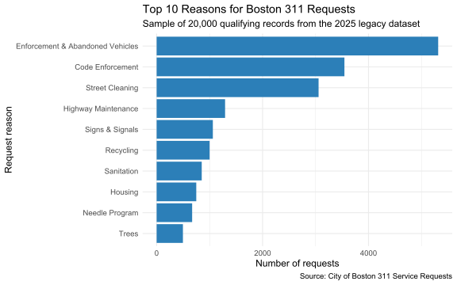
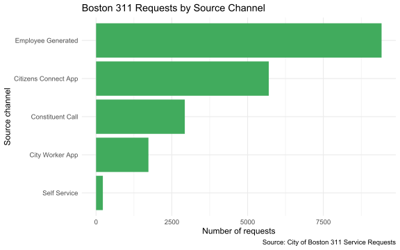
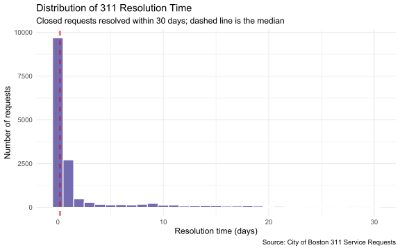
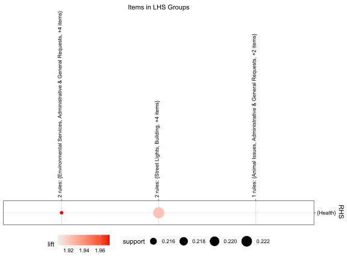

# Boston 311 Service Request Data Mining

This portfolio project applies exploratory data mining and association-rule analysis to public-service data from the City of Boston. It demonstrates how methods commonly used for retail transactions can be adapted to identify patterns in municipal service requests.

## Project questions

- Which 311 request reasons appear most often in the sample?
- How do request volume, on-time performance, and resolution time differ by reporting channel?
- Which service-request reasons commonly occur in the same neighborhood and week?

## Data source

- [City of Boston: 311 Service Requests](https://data.boston.gov/dataset/311-service-requests)
- Resource used: 2025 legacy-system data (`9d7c2214-4709-478a-a2e8-fb2020a5bb94`)
- Analysis sample: 20,000 qualifying records opened from January 1 through February 3, 2025

The R Markdown file downloads the sample through Boston's CKAN API and saves a local copy. The downloaded CSV is excluded from this repository because the source data are public and reproducible.

## Methods and tools

- R and R Markdown
- `dplyr` for preparation and grouped summaries
- `ggplot2` for visualizations
- `arules` and the Apriori algorithm for association rules
- `arulesViz` for a grouped rule visualization
- Support, confidence, and lift for rule evaluation

## Selected findings

- The sample contains 20,000 requests across 23 neighborhoods, 35 request reasons, and 128 request types.
- Employee-generated records were the largest source group in the sample, with 9,421 requests.
- Median resolution time varied by source, from 3.3 hours for the City Worker App to 19.7 hours for constituent calls.
- The strongest association rule linked building and noise-disturbance requests with needle-program requests. It had 20.5% support, 88.5% confidence, and a lift of 1.62.

These findings describe the sample and should not be treated as full-year estimates. Boston 311 data measure reported requests, so differences in access and reporting behavior may influence the results.

## Visualizations

### Frequent request reasons



### Request source channels



### Resolution time



### Association rules



## Repository contents

- `Boston_311_Data_Mining_Example.Rmd`: complete analysis, code, interpretation, and source information
- `figure/`: visualizations generated by the analysis
- `.gitignore`: excludes downloaded data and temporary R files

## Run the project

1. Download or clone the repository.
2. Open `Boston_311_Data_Mining_Example.Rmd` in RStudio.
3. Install the required packages if needed:

```r
install.packages(c(
  "dplyr", "ggplot2", "arules", "arulesViz", "jsonlite", "knitr"
))
```

4. Knit the file. An internet connection is required the first time so the script can obtain the sample from Boston's API.

## Responsible interpretation

Association does not establish causation. The rules depend on the chosen neighborhood-week basket definition, the sample period, the City's request categories, and residents' use of the 311 system. Operational decisions should use the complete dataset, multiple time periods, and input from affected departments and communities.
